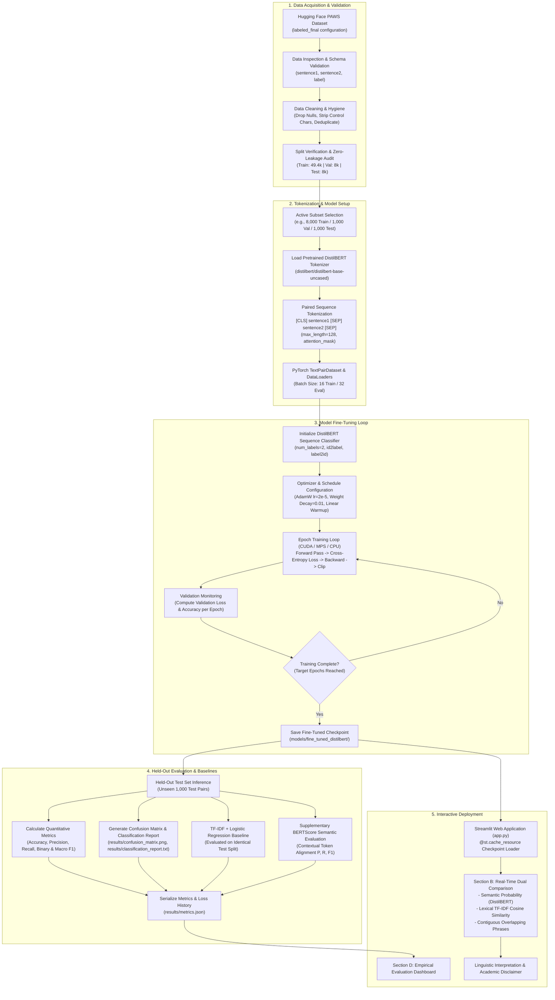

# DistilBERT Fine-Tuning and Evaluation Flowchart

This document illustrates the end-to-end engineering pipeline for the **AI-Powered Plagiarism and Paraphrase Detection System Using Fine-Tuned DistilBERT**.

## Description of Architectural Stages

1. **Data Acquisition & Validation:** Loads the official PAWS `labeled_final` configuration from Hugging Face Datasets, verifies data types, enforces zero null records, normalizes text into Unicode NFKC format, and conducts rigorous cross-split set intersection tests to prevent train-test data leakage.
2. **Tokenization & Model Setup:** Encodes sentence pairs using DistilBERT's paired input format `[CLS] text_a [SEP] text_b [SEP]`. DistilBERT natively learns bidirectional cross-attention across both segments without needing segment token embeddings (`token_type_ids`).
3. **Model Fine-Tuning Loop:** Employs AdamW optimizer with a 10% linear warmup schedule to fine-tune the 66-million parameter transformer. Tracks training and validation loss after every epoch.
4. **Held-Out Evaluation & Baselines:** Computes classification metrics on the official held-out test split. Benchmarks DistilBERT directly against a TF-IDF + Logistic Regression baseline trained on the exact same split, demonstrating transformer superiority on word-scrambled adversarial text pairs.
5. **Interactive Deployment:** Serves the fine-tuned model via a high-performance Streamlit UI (`app.py`), presenting model probabilities, lexical cosine metrics, exact matching phrases, and a clear academic plagiarism disclaimer.
